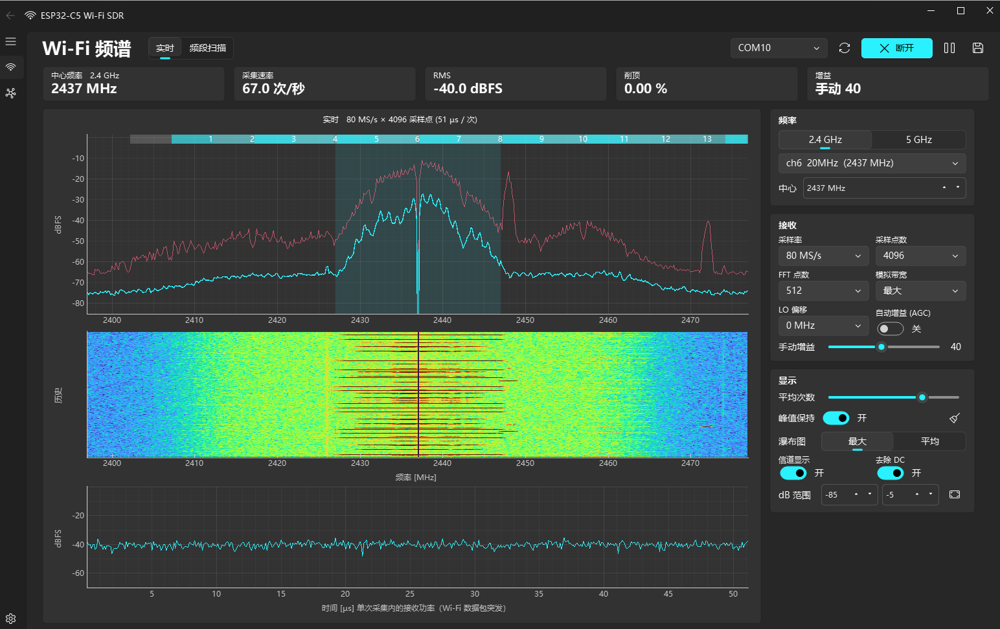
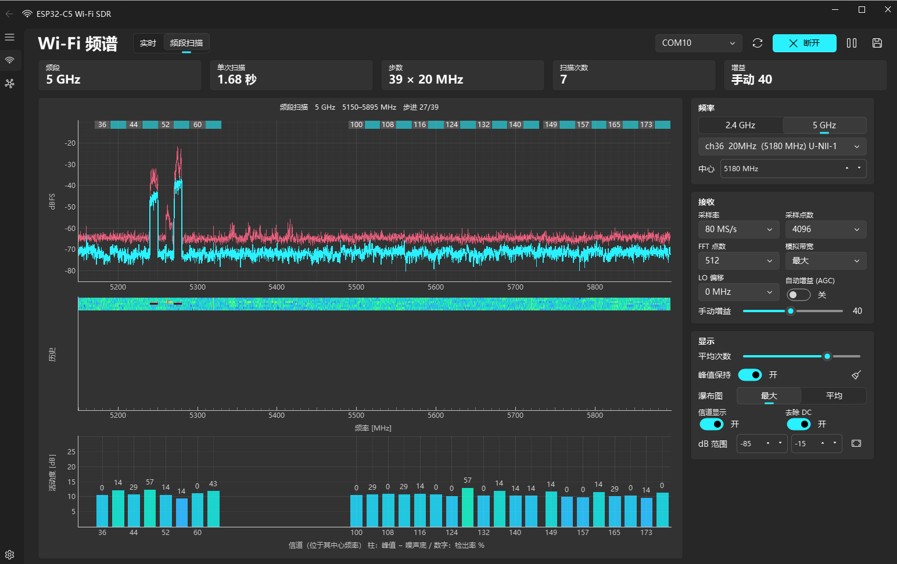

# ESP32-C5 Wi-Fi SDR（2.4 GHz / 5 GHz）

[English](README.md) | [日本語](README.ja.md) | **简体中文**

把 ESP32-C5 内置的 Wi-Fi 6 双频无线电当作 SDR 使用，在电脑上显示 2.4 GHz / 5 GHz 频段的频谱、瀑布图和数据包突发。

- 固件：[ESPARGOS/esp-sdr](https://github.com/ESPARGOS/esp-sdr) 官方预编译镜像（GPL-3.0）
- 上位机：Python（PySide6 + PySide6-Fluent-Widgets + pyqtgraph；经典版用 tkinter + matplotlib），即本仓库的代码
- 协议与实现参考 [ESPARGOS/esp-sdr](https://github.com/ESPARGOS/esp-sdr)（见[致谢](#致谢)）
- 界面可在日语 / 英语 / 简体中文之间实时切换

## 截图

**实时模式（2.4 GHz，ch6）**：频谱（峰值保持与平均）、瀑布图，以及单次采集内接收功率随时间的变化



**频段扫描（5 GHz，5150–5895 MHz）**：整段频谱，以及每个 20 MHz 信道的活动度与检出率



（截图为简体中文界面。）

## 快速开始

**你需要**：一块 ESP32-C5 开发板（Flash ≥ 2 MB）、一根 USB 线，以及一台装有 Python 3.10 或更高版本的电脑（在 Windows 上测试过）

1. **安装依赖**（仅首次）
   ```powershell
   pip install -r requirements.txt
   ```
2. **连接开发板**：把板子上的 “USB” 口（原生 USB）接到电脑，查一下它的 COM 端口号（例如在设备管理器里）。
   **COM 端口号因电脑而异**（换个 USB 口也可能变）。本文里的 `COM6` / `COM7` 只是示例，请以你电脑上显示的为准。
3. **烧写固件**（仅首次）：官方镜像会自动下载，校验 SHA-256 后写入。
   ```powershell
   python flash_c5.py COM7      # 把 COM7 换成你的端口
   ```
4. **启动程序**：端口会自动识别，也可以直接双击 `run_sdr.bat`。
   ```powershell
   python sdr_fluent.py
   ```

**基本操作**
- 顶部 **实时** 只看一个频率；**频段扫描** 看整个 2.4 GHz 或 5 GHz 频段
- 在右侧面板修改中心频率、信道、增益等
- 在图上 **单击** 放置标记，**双击** 调谐到该频率，**右键** 清除标记
- **保存 I/Q** 把接收数据存到 `recordings/`
- 左下 **设置** → **语言** 可在日语 / 英语 / 简体中文之间即时切换，选择会被记住

跑不起来时：如果提示 “No device running the ESP-SDR firmware was found”，先确认第 3 步已完成，
或者显式给出端口，例如 `python sdr_fluent.py COM7`。

## 文件说明

| 文件 | 内容 |
| --- | --- |
| `sdr_fluent.py` | **图形界面（WinUI 3 / Fluent Design 风格）**。PySide6 + PySide6-Fluent-Widgets + pyqtgraph |
| `sdr_app.py` | 经典界面（tkinter + matplotlib）。不装 Qt 库也能运行 |
| `sdr_core.py` | 接收线程与信号处理（两个界面共用） |
| `espsdr.py` | ESP-SDR 串口协议驱动（`INFO` / `FREQ` / `GAIN` / `BANDWIDTH` / `CAP16` 等） |
| `i18n.py` | 界面语言（日语 / 英语 / 简体中文）：翻译表与运行时切换（两个界面共用） |
| `wifi_channels.py` | 2.4 / 5 GHz Wi-Fi 信道表（20/40/80/160 MHz，U-NII-1 ~ 4） |
| `flash_c5.py` | 把固件写入 ESP32-C5（带 SHA-256 校验） |
| `run_sdr.bat` / `run_sdr_classic.bat` | Fluent 版 / 经典版的启动脚本 |
| `firmware/` | 固件镜像（由 `flash_c5.py` 从官网下载；不在仓库中） |
| `recordings/` | 通过 **保存 I/Q** 存下的 I/Q 数据（不在仓库中） |

### Fluent 界面

- 左侧导航：**频谱** / **设备**（连接信息、日志、录制文件夹）/ **设置**（语言、浅色 / 深色 / 跟随系统主题、瀑布图配色）
- 顶部：实时 / 频段扫描切换、端口选择、连接、暂停、保存 I/Q
- 统计卡：中心频率、采集速率、RMS、削顶、增益（扫描模式下为：频段、单次扫描耗时、扫描次数）
- 右侧面板：频率 / 接收 / 增益 / 显示设置
- 横向拖动图形可平移，滚轮缩放
- **单击**：放置标记，显示该频率、信道、平均电平与峰值（dBFS），并实时更新；拖动可移动
- **双击**：调谐到该频率（同时重置平均与峰值）/ **右键**：清除标记

## 用法（命令行参数）

把下面的 `COM6` / `COM7` 换成你自己的 COM 端口（端口号因电脑而异）。

```powershell
pip install -r requirements.txt     # 仅首次
python flash_c5.py COM6             # 仅首次：下载并烧写固件
python sdr_fluent.py                # 启动（端口自动识别）；run_sdr.bat 等价
python sdr_fluent.py --light        # 以浅色主题启动
python sdr_fluent.py --lang zh      # 以简体中文启动（ja / en / zh；默认沿用上次选择，首次为英语）
python sdr_fluent.py --lang en      # 以英语启动
python sdr_app.py                   # 经典界面（tkinter）
python sdr_app.py COM7 --freq 5180  # 指定端口与频率
python sdr_app.py COM7 --sweep 5    # 启动即做 5 GHz 频段扫描（--sweep 2.4 亦可）
python sdr_app.py --samples 2048    # 单次采集的采样点数（默认 4096）
# --freq / --sweep / --samples / --lang 对两个界面都适用
```

建议通过板子上的 **“USB” 口（原生 USB Serial/JTAG）** 连接。
“UART” 口（CH343，2 Mbaud）也能用，但传输速度大约只有一半。

| 连接方式 | 有效吞吐 | 刷新率（8192 采样点） |
| --- | --- | --- |
| 原生 USB | 256 kB/s | 约 15 次/秒（4096：28 次/秒，2048：52 次/秒） |
| UART / CH343 | 133 kB/s | 约 8 次/秒 |

原生 USB 需要上位机拉高 DTR 之后才开始发数据，所以 `espsdr.py` 只对 Espressif 的 USB（VID 0x303A）拉 DTR；
RTS 始终保持无效电平，因此不会复位开发板。

## 功能

**实时模式**（中心频率固定）
- 频谱（平均与峰值保持）、瀑布图
- 单次采集内接收功率随时间的变化（能看到 Wi-Fi 数据包突发）
- Wi-Fi 信道条与所选信道宽度的标注（20/40/80/160 MHz）
- 在频谱或瀑布图上单击放置电平标记，双击调谐到该处（经典界面单击即调谐）
- 采样率 80/40/20/10/8/4 MS/s，FFT 256–2048，模拟带宽 11–48 MHz
- AGC 与手动增益（0–83）、DC 去除、LO 偏移
- I/Q 录制（`.npy`；GNU Radio / inspectrum 可读的 `.cfile`；以及 `.json` 元数据）

**频段扫描模式**（整段）
- 2.4 GHz（2400–2500 MHz）：7 步，单次扫描约 0.5 s
- 5 GHz（5150–5895 MHz，ch36–177）：39 步，单次扫描约 1.6 s（USB + 4096 采样点；走 UART 约 2.7 s）
- 每个 20 MHz 信道的活动度（峰值 − 噪声底）与检出率 %

## 实测特性与注意事项

- **刷新率**：时间几乎都花在串口传输上（PC 端 FFT 只要 0.1 ms）。即使原生 USB 也只有 256 kB/s。
- **观测是断续的快照**：一次采集是 80 MS/s × 8192 采样点 ≈ 100 µs。
  两次采集之间什么也收不到，所以并非每个数据包都能看到（峰值保持有帮助）。
- **通带**：中心 ±22 MHz 左右平坦；即使在 80 MS/s 下两侧也会滚降。
  80 MHz 与 160 MHz 信道无法一次看全（请用扫描模式）。
- **5 GHz 的 LO 泄漏**：5.45 GHz 以上，本振会泄漏到 LO 附近约 ±5 MHz。
  扫描模式只拼接距 LO 10–20 MHz 之外的部分来避开它。
  实时模式下若观察的信道与 LO 重叠，把 **LO 偏移** 设为 ±12 / ±16 MHz。
- **扫描时的增益**：AGC 会在每一步改变增益，导致谱线出现台阶，所以扫描始终使用手动增益
  （默认 60，实测既不轻易饱和又能看到噪声底）。
- **电平**：dBFS 是未校准的相对值（不是 dBm）。
- 5 GHz 的接收请遵守所在国家的无线电法规。本固件不发射。

## 协议概览（`espsdr.py`）

发送以换行结尾的 ASCII 命令，接收文本回复。`CAP16 <n> <rate>` 的回复是
`DATA <n> <crc32> <µs>`，随后是 `n×2` 字节（有符号 8 位 I、Q 交替），用
CRC32（zlib 兼容）校验。速率索引 0–5 分别对应 80/40/20/10/8/4 MS/s。
细节见上游 README 与 `docs/rx-controls.md`。

## 绘制如何保持流畅

- 一帧之内收到的每次采集都会被折进显示（平均、峰值与瀑布图行），所以绘制再慢也不会丢数据。
- 坐标轴、刻度与信道条缓存为背景；每帧只重绘曲线与瀑布图图像（matplotlib blitting）。
- 每秒能观测到的信号量受传输速度限制，约 110–120 k 采样点/秒（约为 80 MS/s 的 0.15%）。
  单次采集的采样点越少，刷新越快，但每次观测的时间也越短。

## 致谢

本项目基于 [ESPARGOS/esp-sdr](https://github.com/ESPARGOS/esp-sdr)。

- 运行在 ESP32-C5 上的固件是 esp-sdr 官方预编译镜像，原样使用（由 `flash_c5.py` 从[官方安装器](https://espargos.net/espsdr/app/firmware/)下载）。
- `espsdr.py` 里的串口协议（命令、`CAP16` 回复格式、速率索引等）是依据 esp-sdr 的 README 与 `docs/rx-controls.md` 实现的。

esp-sdr 固件以 GPL-3.0 分发，源码可从上面的仓库获取。

## 许可证

本仓库的代码以 [GNU General Public License v3.0](LICENSE)（GPL-3.0-or-later）发布。

主要依赖的许可证（通过 pip 安装，不包含在本仓库中）：

| 库 | 许可证 |
| --- | --- |
| PySide6 | LGPL-3.0 |
| PySide6-Fluent-Widgets | GPL-3.0（商业使用需单独授权） |
| pyqtgraph | MIT |
| numpy / pyserial | BSD |
| matplotlib | Matplotlib License（基于 PSF） |
| esptool | GPL-2.0-or-later（作为独立进程运行） |
